# 🌧️ AI-Based Monthly Rainfall Analysis, Forecasting, and Seasonal Pattern Prediction System

## 📌 Project Overview

The **AI-Based Monthly Rainfall Analysis, Forecasting, and Seasonal Pattern Prediction System** is a machine learning project designed to analyze historical rainfall records, identify seasonal rainfall patterns, and forecast future monthly rainfall.

The system integrates traditional Machine Learning, Artificial Neural Networks (ANN), Artificial Immune System (AIS), and Particle Swarm Optimization (PSO) to develop and compare rainfall prediction models.

The project uses historical monthly rainfall data and applies feature engineering, time-series analysis, regression techniques, and optimization algorithms to improve rainfall forecasting performance.

The system generates trained models, prediction datasets, performance evaluation reports, and graphical visualizations.

---

## 🎯 Project Objectives

The primary objectives of this project are:

- Analyze historical monthly rainfall data.
- Identify seasonal rainfall trends and patterns.
- Understand variations in rainfall across different months and years.
- Develop machine learning models for rainfall forecasting.
- Implement Artificial Neural Networks for rainfall prediction.
- Optimize machine learning models using Artificial Immune System (AIS).
- Optimize machine learning models using Particle Swarm Optimization (PSO).
- Compare baseline, AIS-optimized, and PSO-optimized models.
- Evaluate forecasting performance using statistical regression metrics.
- Generate future monthly rainfall predictions.
- Visualize rainfall patterns, model performance, and prediction results.
- Save trained models and results for future use.

---

## 📊 Project Visualization

The following visualization displays the performance of the baseline machine learning models.

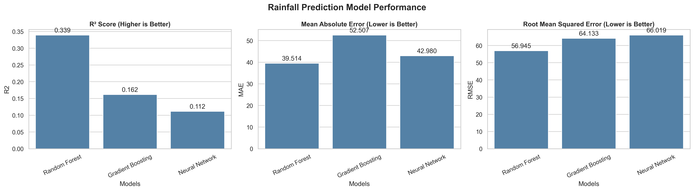

**Figure 1: Rainfall Forecasting Model Performance Comparison**

The graph compares the performance of Random Forest, Gradient Boosting, and Artificial Neural Network models.

The evaluation includes:

- **R² Score:** Measures how well the model explains variations in rainfall.
- **Mean Absolute Error (MAE):** Measures the average absolute prediction error.
- **Root Mean Squared Error (RMSE):** Measures prediction error while giving greater weight to large deviations.

A higher R² score and lower MAE and RMSE indicate better predictive performance.

Since rainfall forecasting is a regression task, these metrics are more appropriate than classification accuracy.

---

## 📂 Dataset Description

### Dataset Name

`D67. Rainfall Monthly Total_1_0.csv`

The dataset contains historical monthly rainfall observations.

### Dataset Features

| Feature | Description |
|---------|-------------|
| Month-Year | Month and year of rainfall observation |
| Total_rainfall | Total rainfall recorded during the month |

### Dataset Characteristics

- Dataset type: Time-series dataset
- Data format: CSV
- Target variable: `Total_rainfall`
- Prediction task: Regression
- Observation frequency: Monthly
- Primary application: Monthly rainfall forecasting

### Data Processing

The following preprocessing operations are performed:

1. Load the rainfall dataset using Pandas.
2. Validate the required columns.
3. Convert month-year values into datetime format.
4. Convert rainfall measurements into numeric values.
5. Remove invalid or missing records.
6. Sort rainfall observations chronologically.
7. Check for duplicate months.
8. Validate monthly continuity.
9. Generate time-series features.
10. Divide the dataset into chronological training, validation, and testing sets.

Chronological splitting is used instead of random splitting to preserve the temporal structure of rainfall observations.

---

## 🧠 Machine Learning Algorithms

The project implements multiple machine learning approaches.

### 1. Random Forest Regressor

Random Forest is an ensemble learning algorithm that combines predictions from multiple decision trees.

It is used to identify nonlinear relationships between historical rainfall observations and future rainfall amounts.

**Advantages:**

- Handles nonlinear relationships.
- Works with multiple input features.
- Reduces overfitting compared with individual decision trees.
- Provides feature importance information.

### 2. Gradient Boosting Regressor

Gradient Boosting combines multiple weak prediction models sequentially.

Each new model attempts to reduce the errors made by previous models.

**Advantages:**

- Learns complex nonlinear patterns.
- Can achieve strong regression performance.
- Supports flexible hyperparameter tuning.

### 3. Artificial Neural Network (ANN)

An Artificial Neural Network learns complex relationships between rainfall history, seasonal patterns, and time-series features.

The neural network contains:

- Input layer
- Hidden dense layers
- ReLU activation functions
- Output layer for rainfall prediction

The model is trained using the Adam optimizer and Mean Squared Error loss.

---

## 🧬 Artificial Immune System (AIS)

### Overview

Artificial Immune System is a computational optimization approach inspired by biological immune systems.

This project implements a Clonal Selection Algorithm (CLONALG)-inspired optimization process.

AIS is used to optimize the hyperparameters of Random Forest and Artificial Neural Network models.

### AIS Optimization Process

1. Initialize a population of candidate solutions called antibodies.
2. Encode model hyperparameters into antibodies.
3. Evaluate each antibody using validation RMSE.
4. Select high-quality antibodies.
5. Clone the selected antibodies.
6. Apply mutation to generate new solutions.
7. Introduce random candidates to maintain diversity.
8. Repeat the optimization process.
9. Select the best hyperparameter configuration.
10. Train the optimized forecasting model.

### AIS-Optimized Models

- AIS Random Forest Regressor
- AIS Artificial Neural Network

### AIS Outputs

- `ais_rainfall_model.pkl`
- `ais_rainfall_model.h5`
- `ais_config.yaml`
- `ais_model_info.json`
- `ais_accuracy_graph.png`
- `ais_comparison_graph.png`
- `ais_heatmap.png`
- `ais_result.csv`
- `ais_result_graph.png`
- `ais_prediction.csv`
- `ais_prediction_graph.png`
- `ais_fitness_graph.png`
- `ais_model_comparison.csv`

---

## 🐝 Particle Swarm Optimization (PSO)

### Overview

Particle Swarm Optimization is a population-based optimization algorithm inspired by the collective movement of birds and fish.

Each particle represents a candidate solution containing machine learning hyperparameters.

Particles update their positions based on their individual best solutions and the global best solution.

### PSO Optimization Process

1. Initialize a swarm of particles.
2. Assign random positions and velocities.
3. Decode particle positions into model hyperparameters.
4. Train the model using each parameter configuration.
5. Calculate validation RMSE.
6. Update each particle's personal best position.
7. Update the global best position.
8. Update particle velocities and positions.
9. Repeat until the configured iterations are completed.
10. Select the optimized hyperparameters.

### PSO Velocity Equation

The particle velocity is updated using:

v(t+1) = w × v(t)
       + c1 × r1 × (pbest - x(t))
       + c2 × r2 × (gbest - x(t))

Where:

- `w` = Inertia weight
- `c1` = Cognitive coefficient
- `c2` = Social coefficient
- `r1`, `r2` = Random values
- `pbest` = Personal best position
- `gbest` = Global best position
- `x(t)` = Current particle position

The particle position is updated as:

x(t+1) = x(t) + v(t+1)

### PSO-Optimized Models

- PSO Random Forest Regressor
- PSO Artificial Neural Network

### PSO Outputs

- `pso_rainfall_model.pkl`
- `pso_rainfall_model.h5`
- `pso_config.yaml`
- `pso_model_info.json`
- `pso_accuracy_graph.png`
- `pso_comparison_graph.png`
- `pso_heatmap.png`
- `pso_result.csv`
- `pso_result_graph.png`
- `pso_prediction.csv`
- `pso_prediction_graph.png`
- `pso_fitness_graph.png`
- `pso_model_comparison.csv`
- `pso_feature_importance.csv`
- `pso_feature_importance.png`

---

## ⚙️ Feature Engineering

Feature engineering transforms historical rainfall observations into useful inputs for machine learning.

The project creates the following features:

| Feature | Description |
|---------|-------------|
| month | Calendar month |
| month_sin | Sine transformation of month |
| month_cos | Cosine transformation of month |
| time_index | Sequential observation index |
| lag_1 | Previous month's rainfall |
| lag_2 | Rainfall two months earlier |
| lag_3 | Rainfall three months earlier |
| lag_6 | Rainfall six months earlier |
| lag_12 | Rainfall twelve months earlier |
| rolling_mean_3 | Average rainfall of previous three months |
| rolling_mean_6 | Average rainfall of previous six months |
| rolling_std_3 | Rainfall variation over previous three months |
| rolling_std_6 | Rainfall variation over previous six months |

### Seasonal Encoding

Calendar months are converted into cyclical features.

month_sin = sin(2π × month / 12)

month_cos = cos(2π × month / 12)

These features help machine learning models represent annual seasonality.

### Lag Features

Lag features allow the model to use previous rainfall observations when predicting the current month.

For example:

- January rainfall can be predicted using rainfall from previous months.
- A twelve-month lag provides information about the same month in the previous year.

### Rolling Statistics

Rolling mean and standard deviation features summarize historical rainfall behavior.

All rolling features use previous observations to prevent direct target leakage.

---

## 🏗️ System Architecture

```text
                Historical Rainfall Dataset
                           |
                           v
                   Data Preprocessing
                           |
                           v
                   Feature Engineering
                           |
                           v
               Chronological Data Splitting
                           |
             +-------------+-------------+
             |                           |
             v                           v
      Baseline Models             Optimization Models
             |                           |
      +------+------+             +------+------+
      |             |             |             |
 Random Forest  Gradient       AIS Models    PSO Models
                Boosting           |             |
      |                         +--+--+       +--+--+
      |                         |     |       |     |
      |                        RF    ANN     RF    ANN
      |                         |     |       |     |
      +-------------------------+-----+-------+-----+
                                |
                                v
                       Model Evaluation
                                |
                                v
                    Performance Comparison
                                |
                                v
                      Rainfall Forecasting
                                |
                                v
                       Result Generation
                                |
                 +--------------+--------------+
                 |              |              |
                 v              v              v
             CSV Files      PNG Graphs     Saved Models
```

---

## 🛠️ Technologies Used

### Programming Language

- Python

### Data Processing

- Pandas
- NumPy

### Machine Learning

- Scikit-learn

### Deep Learning

- TensorFlow
- Keras

### Data Visualization

- Matplotlib
- Seaborn

### Optimization Algorithms

- Artificial Immune System (AIS)
- Particle Swarm Optimization (PSO)

### Model Serialization

- Joblib
- HDF5

### Configuration and Metadata

- YAML
- JSON

### Development Environment

- Jupyter Notebook
- Visual Studio Code
- Python IDE

---

## 📁 Project Directory Structure

```text
AI-Based Monthly Rainfall Analysis, Forecasting, and Seasonal Pattern Prediction System/
│
├── D67. Rainfall Monthly Total_1_0.csv
│
├── rainfall_training.py
├── rainfall_visualization.py
├── ais_rainfall.py
├── pso_rainfall.py
│
├── rainfall_model.pkl
├── rainfall_model.h5
├── config.yaml
├── model_info.json
│
├── accuracy_graph.png
├── comparison_graph.png
├── heatmap.png
├── result.csv
├── result_graph.png
├── prediction.csv
├── prediction_graph.png
├── model_comparison.csv
├── visualization_results.json
│
├── ais_rainfall_model.pkl
├── ais_rainfall_model.h5
├── ais_config.yaml
├── ais_model_info.json
├── ais_accuracy_graph.png
├── ais_comparison_graph.png
├── ais_heatmap.png
├── ais_result.csv
├── ais_result_graph.png
├── ais_prediction.csv
├── ais_prediction_graph.png
├── ais_fitness_graph.png
├── ais_model_comparison.csv
│
├── pso_rainfall_model.pkl
├── pso_rainfall_model.h5
├── pso_config.yaml
├── pso_model_info.json
├── pso_accuracy_graph.png
├── pso_comparison_graph.png
├── pso_heatmap.png
├── pso_result.csv
├── pso_result_graph.png
├── pso_prediction.csv
├── pso_prediction_graph.png
├── pso_fitness_graph.png
├── pso_model_comparison.csv
├── pso_feature_importance.csv
├── pso_feature_importance.png
│
└── README.md
```

---

## 🚀 Installation and Setup

### Step 1: Clone the Repository

```bash
git clone https://github.com/YOUR_USERNAME/YOUR_REPOSITORY.git
```

Replace the placeholder URL with your actual GitHub repository URL.

### Step 2: Navigate to the Project Directory

```bash
cd "AI-Based Monthly Rainfall Analysis, Forecasting, and Seasonal Pattern Prediction System"
```

### Step 3: Create a Virtual Environment

```bash
python -m venv venv
```

### Step 4: Activate the Environment

Windows:

```bash
venv\Scripts\activate
```

Linux/macOS:

```bash
source venv/bin/activate
```

### Step 5: Install Dependencies

```bash
pip install numpy pandas scikit-learn tensorflow matplotlib seaborn pyyaml joblib h5py
```

### Step 6: Configure Dataset Path

Update the `ROOT` variable in each Python script.

```python
from pathlib import Path

ROOT = Path(
    r"C:\Users\sagni\Downloads\AI-Based Monthly Rainfall Analysis, Forecasting, and Seasonal Pattern Prediction System"
)

CSV_PATH = ROOT / "D67. Rainfall Monthly Total_1_0.csv"
```

Ensure that the dataset exists at the specified location.

---

## ▶️ How to Run the Project

### 1. Train Baseline Models

```bash
python rainfall_training.py
```

This script:

- Loads the dataset.
- Generates time-series features.
- Trains Random Forest and Gradient Boosting models.
- Trains an Artificial Neural Network.
- Evaluates prediction performance.
- Saves `.pkl` and `.h5` models.
- Saves configuration and metadata.
- Generates future rainfall predictions.

### 2. Generate Baseline Visualizations

```bash
python rainfall_visualization.py
```

This script generates:

- Accuracy/performance graph
- Model comparison graph
- Correlation heatmap
- Actual vs predicted rainfall CSV
- Actual vs predicted rainfall graph
- Future prediction CSV
- Future prediction graph

### 3. Run AIS Optimization

```bash
python ais_rainfall.py
```

This script:

- Implements Artificial Immune System optimization.
- Optimizes Random Forest hyperparameters.
- Optimizes neural network hyperparameters.
- Generates AIS model evaluation results.
- Saves AIS models and visualizations.

### 4. Run PSO Optimization

```bash
python pso_rainfall.py
```

This script:

- Implements Particle Swarm Optimization.
- Optimizes Random Forest hyperparameters.
- Optimizes neural network hyperparameters.
- Generates PSO model evaluation results.
- Saves PSO models and visualizations.

---

## 📈 Model Evaluation Metrics

The project evaluates forecasting models using three regression metrics.

### 1. Mean Absolute Error (MAE)

MAE measures the average absolute difference between actual and predicted rainfall.

MAE = (1/n) × Σ|Actual - Predicted|

A lower MAE indicates better forecasting performance.

### 2. Root Mean Squared Error (RMSE)

RMSE measures the square root of the average squared prediction error.

RMSE = √[(1/n) × Σ(Actual - Predicted)²]

A lower RMSE indicates better prediction performance.

RMSE penalizes larger prediction errors more heavily than MAE.

### 3. R² Score

R² measures how much of the variation in rainfall is explained by the model.

R² = 1 - [Σ(Actual - Predicted)² / Σ(Actual - Mean Actual)²]

A value closer to 1 indicates stronger predictive performance.

R² can also be negative when a model performs worse than predicting the test-set mean.

---

## 📊 Model Performance Comparison

The project evaluates the following models:

| Model | Optimization | Evaluation |
|-------|--------------|------------|
| Random Forest | None | MAE, RMSE, R² |
| Gradient Boosting | None | MAE, RMSE, R² |
| Artificial Neural Network | None | MAE, RMSE, R² |
| AIS Random Forest | AIS | MAE, RMSE, R² |
| AIS Neural Network | AIS | MAE, RMSE, R² |
| PSO Random Forest | PSO | MAE, RMSE, R² |
| PSO Neural Network | PSO | MAE, RMSE, R² |

The actual performance metrics are generated during program execution.

Results can be inspected in:

- `model_comparison.csv`
- `ais_model_comparison.csv`
- `pso_model_comparison.csv`

AIS and PSO do not guarantee better performance in every experiment. Their effectiveness depends on the dataset, optimization search space, and model configuration.

For rigorous cross-method comparisons, all models should be evaluated using the same chronological test period.

---

## 📉 Generated Visualizations

### 1. Baseline Model Performance


Displays R², MAE, and RMSE for baseline models.

### 2. Baseline Model Comparison

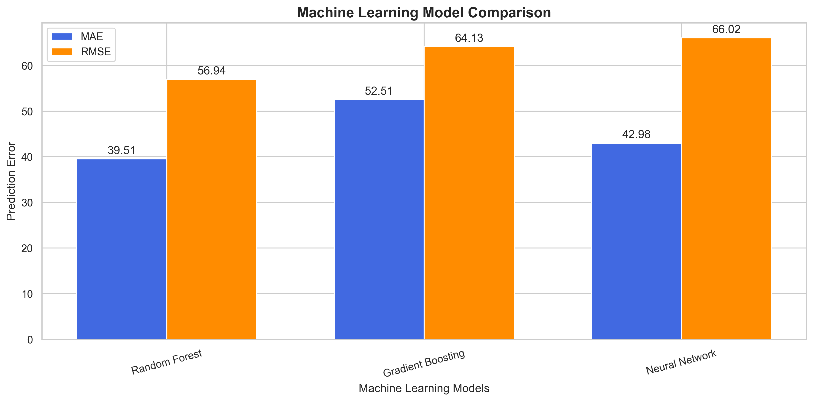

Compares prediction errors across baseline models.

### 3. Correlation Heatmap

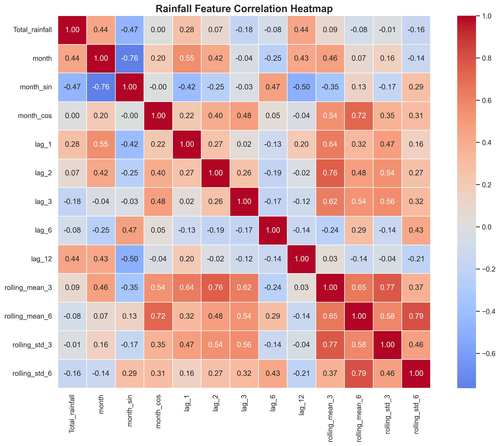

Shows relationships between rainfall and engineered features.

### 4. Actual vs Predicted Rainfall

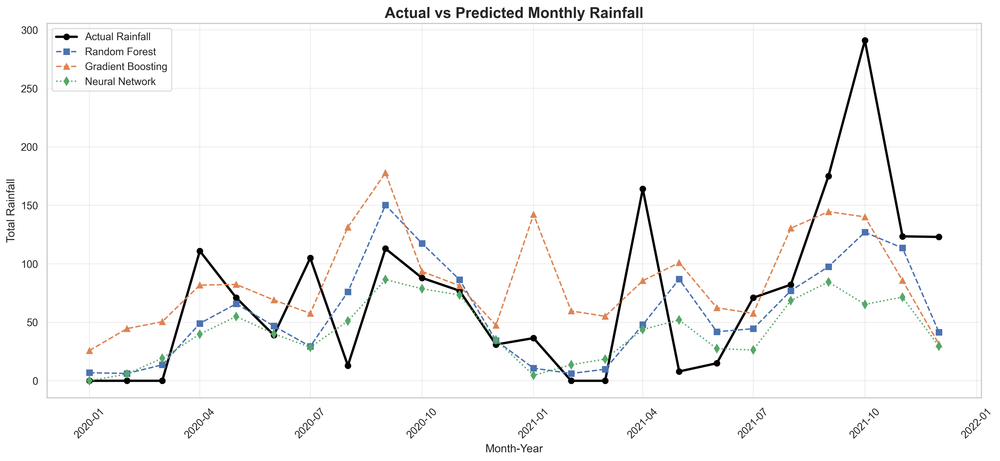

Compares observed rainfall values with model predictions on the test dataset.

### 5. Future Rainfall Forecast

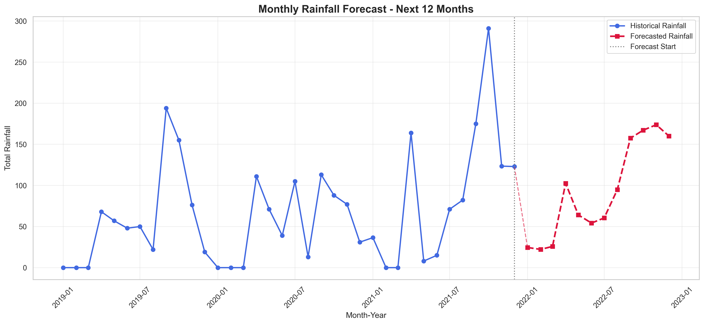

Displays historical rainfall observations and the next twelve forecasted months.

### 6. AIS Model Performance

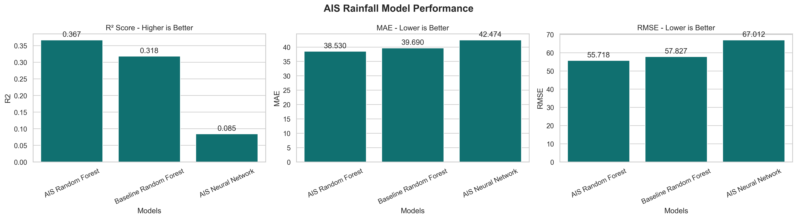

Displays the performance of baseline and AIS-optimized models.

### 7. AIS Optimization Convergence

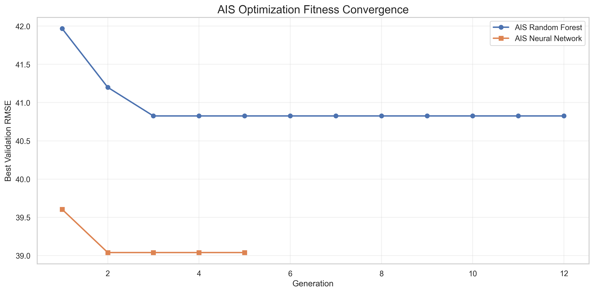

Shows how the best validation RMSE changes across AIS generations.

### 8. AIS Rainfall Forecast


Displays the rainfall predictions generated using the selected model from the AIS experiment.

### 9. PSO Model Performance

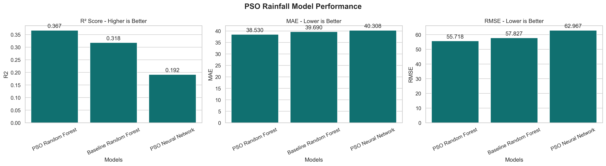

Displays baseline and PSO-optimized model performance.

### 10. PSO Optimization Convergence

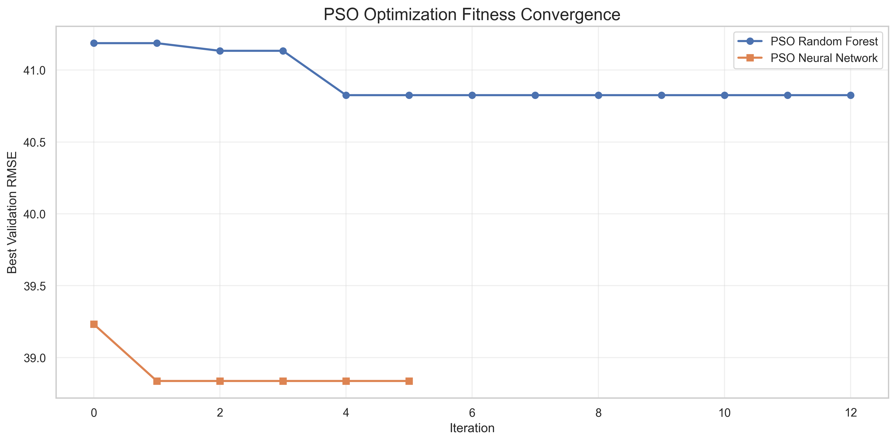

Shows the best validation RMSE across PSO iterations.

### 11. PSO Feature Importance

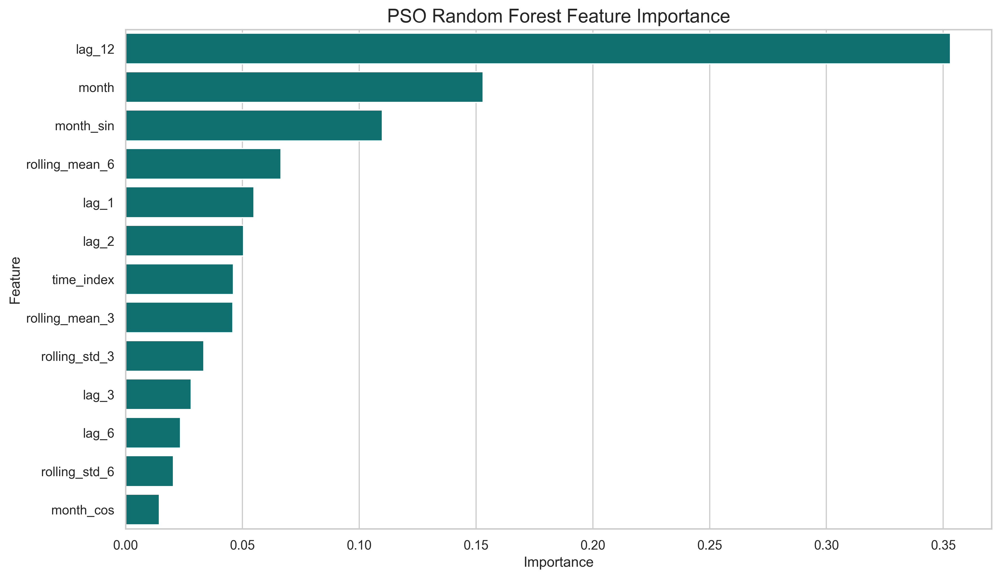

Shows the relative importance of engineered rainfall features in the PSO-optimized Random Forest model.

### 12. PSO Rainfall Forecast

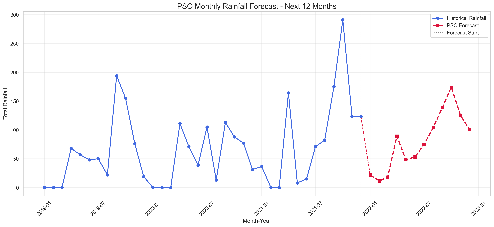

Displays the future rainfall predictions generated by the selected model from the PSO experiment.

---

## 📄 Result CSV Files

### Baseline Results

`result.csv`

Contains:

- Month-Year
- Actual rainfall
- Random Forest prediction
- Gradient Boosting prediction
- Neural Network prediction
- Best model prediction
- Absolute error
- Squared error

### AIS Results

`ais_result.csv`

Contains:

- Month-Year
- Actual rainfall
- Baseline Random Forest prediction
- AIS Random Forest prediction
- AIS Neural Network prediction
- Best model prediction
- Absolute error
- Squared error

### PSO Results

`pso_result.csv`

Contains:

- Month-Year
- Actual rainfall
- Baseline Random Forest prediction
- PSO Random Forest prediction
- PSO Neural Network prediction
- Best model prediction
- Absolute error
- Squared error

These files allow detailed analysis of model performance.

---

## 🔮 Future Rainfall Prediction

The system generates twelve-month rainfall forecasts using historical rainfall observations.

The forecasting process includes:

1. Extracting the latest available rainfall observations.
2. Generating lag and rolling statistical features.
3. Preparing seasonal features for the next month.
4. Predicting rainfall using the selected model.
5. Adding the predicted value to the historical sequence.
6. Repeating the process for the remaining forecast months.

This technique is known as **recursive multi-step forecasting**.

### Prediction Output Files

- `prediction.csv`
- `ais_prediction.csv`
- `pso_prediction.csv`

Each prediction file includes the forecast month and predicted rainfall amount.

The forecast begins immediately after the final observation in the dataset, not necessarily after the current calendar month.

---

## 💾 Model Storage

The project saves trained models for reuse.

### PKL Files

```text
rainfall_model.pkl
ais_rainfall_model.pkl
pso_rainfall_model.pkl
```

These files contain serialized machine learning models and related preprocessing information.

### H5 Files

```text
rainfall_model.h5
ais_rainfall_model.h5
pso_rainfall_model.h5
```

These files store trained Keras neural network models.

### YAML Files

```text
config.yaml
ais_config.yaml
pso_config.yaml
```

These files store project settings and optimization configurations.

### JSON Files

```text
model_info.json
ais_model_info.json
pso_model_info.json
```

These files store model information, hyperparameters, evaluation metrics, and metadata.

---

## 🔍 Applications

The proposed system can support research and analysis in several areas.

### Agricultural Planning

Historical rainfall analysis can help researchers study seasonal rainfall behavior relevant to agricultural activities.

### Water Resource Management

Rainfall forecasts may provide supporting information for long-term water resource planning.

### Environmental Research

The system can be used to investigate historical rainfall variability and seasonal patterns.

### Climate Data Analysis

The project provides a machine learning framework for exploring rainfall time-series datasets.

### Academic Research

The system demonstrates the integration of regression, deep learning, and bio-inspired optimization algorithms.

---

## ⚠️ Limitations

The project has several important limitations:

1. **Limited dataset size:** A small monthly dataset may not provide enough information for complex neural networks.

2. **Historical-data dependence:** Predictions rely on patterns present in historical rainfall observations.

3. **Missing meteorological variables:** The models do not directly use temperature, humidity, atmospheric pressure, or wind conditions.

4. **Recursive forecast uncertainty:** Errors may accumulate when earlier predictions are reused to forecast later months.

5. **Model instability:** Neural network and optimization results can vary across training runs.

6. **Optimization limitations:** AIS and PSO search for better hyperparameters but do not guarantee globally optimal solutions.

7. **Evaluation limitations:** A single chronological test split provides limited evidence of forecasting performance.

8. **Not an operational weather forecast:** Predictions are experimental estimates and should not be used as the sole basis for safety-critical decisions.

---

## 🚀 Future Enhancements

Potential improvements include:

- Integration of real-time rainfall observations.
- Addition of temperature and humidity features.
- Integration of atmospheric pressure and wind information.
- Implementation of LSTM and GRU forecasting models.
- Implementation of SARIMA and other statistical forecasting methods.
- Time-series cross-validation.
- Walk-forward forecasting evaluation.
- Prediction intervals and uncertainty estimation.
- Hybrid AIS-PSO optimization.
- Seasonal rainfall anomaly detection.
- Geographic rainfall analysis.
- Interactive Streamlit dashboard.
- Automated rainfall forecasting reports.
- Deployment as a web application.
- Integration with weather data APIs.

---

## 🧪 Research Significance

This project demonstrates how machine learning and nature-inspired optimization algorithms can be integrated for environmental time-series prediction.

The research investigates whether hyperparameter optimization using AIS and PSO improves rainfall forecasting compared with baseline machine learning models.

The project also explores the importance of seasonal encoding, historical lag features, and rolling statistics in monthly rainfall prediction.

Model performance is evaluated using MAE, RMSE, and R².

The generated results support comparative analysis of traditional and optimization-enhanced machine learning approaches.

---

## 📌 Key Features

- Historical rainfall analysis
- Monthly rainfall forecasting
- Seasonal pattern identification
- Time-series feature engineering
- Random Forest regression
- Gradient Boosting regression
- Artificial Neural Network
- Artificial Immune System optimization
- Particle Swarm Optimization
- Model performance comparison
- Correlation heatmap generation
- Optimization convergence visualization
- Feature importance analysis
- Future rainfall prediction
- Automated CSV generation
- Model serialization using PKL and H5
- Configuration management using YAML
- Metadata storage using JSON
- High-resolution graphical outputs

---

## 📜 Conclusion

The **AI-Based Monthly Rainfall Analysis, Forecasting, and Seasonal Pattern Prediction System** provides a comprehensive framework for analyzing historical rainfall observations and predicting future monthly rainfall.

By combining traditional machine learning models, Artificial Neural Networks, Artificial Immune System optimization, and Particle Swarm Optimization, the project supports comparative research into rainfall forecasting techniques.

The system automates data preprocessing, feature engineering, model training, hyperparameter optimization, evaluation, visualization, and prediction generation.

Its modular design allows future integration of additional meteorological variables, advanced forecasting models, and interactive applications.

The project is suitable for academic experimentation, machine learning research, environmental data analysis, and further development of rainfall forecasting systems.

---

## 📄 License

This project is intended for educational and research purposes.

A formal open-source license can be added according to the repository owner's requirements.

---

## ⭐ Project Summary

**Project:** AI-Based Monthly Rainfall Analysis, Forecasting, and Seasonal Pattern Prediction System

**Language:** Python

**Domain:** Machine Learning, Deep Learning, Time-Series Forecasting

**Optimization:** Artificial Immune System (AIS), Particle Swarm Optimization (PSO)

**Models:** Random Forest, Gradient Boosting, Artificial Neural Network

**Dataset:** Monthly Rainfall Total

**Evaluation:** MAE, RMSE, R²

**Outputs:** PKL, H5, YAML, JSON, CSV, PNG

**Forecasting Horizon:** 12 Months

---

### 🌧️ Predicting Rainfall Patterns Through Machine Learning and Nature-Inspired Optimization
